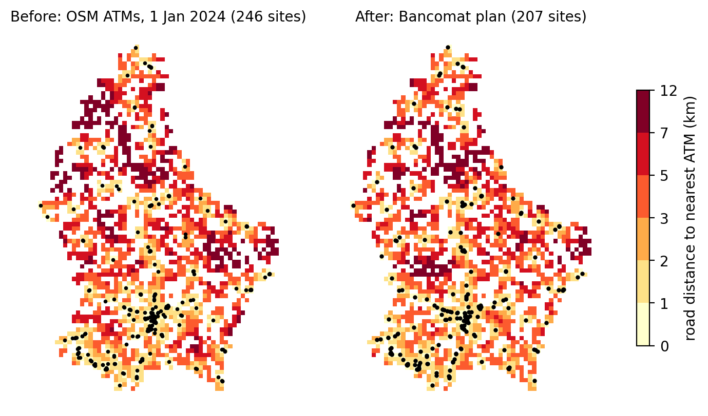

# Access to cash after ATM consolidation in Luxembourg

Luxembourg's five largest retail banks are replacing their separate ATM fleets with one shared network, **Bancomat** (about 237 machines, against 595 cash machines in 2019). This repository measures what the change means for residents' access to cash, with open data only: the 2021 census on the 1 km grid, the public Bancomat locator, ATM locations recovered from OpenStreetMap at four dates, and road distances on the national road network.

This is a preliminary analysis, prepared in November 2026 for an application to a doctoral position on cash infrastructures: a first look with open data, to understand the problem and test one possible research direction, not a finished study.

Technical note: [`report/Access_to_Cash_Luxembourg_Guilarte_Homayden.pdf`](report/Access_to_Cash_Luxembourg_Guilarte_Homayden.pdf)

## Main results (road distances)

| Network | Sites | Mean km | Median km | Within 1 km | Within 5 km | Residents beyond 5 km |
|---|---|---|---|---|---|---|
| Bancomat plan (locator, 5 Nov 2026) | 207 | 1.82 | 1.14 | 42.6% | 92.8% | 46,073 |
| OpenStreetMap ATMs, January 2024 | 246 | 1.93 | 1.16 | 43.0% | 90.1% | 63,497 |

1. **The operator's figure is reproduced.** 92.8% of residents will live within 5 km by road of a Bancomat machine; the operator announced about 92%. Access is less dense than in Austria (mean road distance 1.82 km vs. 1.2 km; Stix, 2020), and residents of communes with fewer than 2,000 inhabitants are on average 4.61 km from a machine.
2. **Lost access, as lower bounds.** OpenStreetMap records only part of the old networks. Missing machines can only shorten the true "before" distances, so increases computed from the mapped network are lower bounds: at least **14,601** residents will be more than 2 km farther from cash, and at least **10,807** move beyond 5 km. The largest increases are in Saeul, Sandweiler, Kehlen, Putscheid, Lintgen, and Helperknapp.
3. **Placement.** Thirteen machines added by a greedy maximal-covering rule raise coverage within 5 km to **97.1%**, against 94% for the 13 sites the operator has identified. The first three fall in Helperknapp, Grosbous, and Contern. The comparison counts residents only; the plan also serves commuters and shoppers.



## Reproduce

```
pip install -r requirements.txt
python src/fetch_osm_atms.py     # OpenStreetMap ATMs at 2019-07-01, 2024-01-01, 2026-06-01, now (Overpass API)
python src/road_distances.py     # road network (OSMnx), multi-source Dijkstra, cell-to-cell matrix
python src/analysis.py           # tables, bounds, placement, figures
python tests/test_road_distances.py
```

On Windows, `run_all.ps1` runs the first four lines. Downloads and road distances take about 20 minutes; the analysis takes about ten seconds. Without road distances, `analysis.py` falls back to straight-line distances and says so.

## Repository

| Path | Content |
|---|---|
| `data/raw/` | Census grid, commune age structure, Bancomat locator snapshot, OpenStreetMap ATMs; sources in `SOURCES.md` |
| `data/derived/road_distance_by_cell.csv` | Road distance from every populated cell to the nearest site, by network |
| `src/laea.py` | EPSG:3035 (ETRS89-LAEA) projection, checked against the official grid corners |
| `src/road_distances.py` | Road graph, snapping, multi-source Dijkstra, cell-to-cell distances |
| `src/analysis.py` | Coverage, bounds on lost access, equity checks, maximal covering and p-median placement |
| `results/` | `results.json`, `summary.md`, `communes.csv` (102 communes) |
| `tests/` | Multi-source Dijkstra checked against brute force on synthetic road grids |

## Limitations

The Bancomat map is indicative and some sites are still to be confirmed. The legacy record is incomplete, so changes are reported as bounds. Distances run from cell centroids. Age is measured at commune level (2018). Commuters, shoppers, and cross-border residents are outside the model; bank and central bank transaction data would be needed to weigh them.

## Data licenses

OpenStreetMap data © OpenStreetMap contributors, ODbL. Census grid and commune data: STATEC, via the Geoportail Luxembourg open data API. Bancomat locations: public locator at bancomat.lu.

**Use of AI tools.** Claude (Anthropic) was used as an assistant for the Python implementation.

## Citation

Guilarte Homayden, E. (2026). *Access to Cash after ATM Consolidation in Luxembourg: Road Distances, Bounds on Lost Access, and Machine Placement*. Technical note. https://github.com/GeneTheStoic/cash-access-luxembourg

MIT license for the code.
